# Lyre

A nostalgic music player for iPhone, in three styles.

Lyre plays your Apple Music library through a player you can touch: a **Classic** scroll-wheel player, a **Spool** cassette deck, or a **Gramophone**. Browse your songs, albums, artists, playlists and podcasts by spinning a wheel, flipping through a rack of tapes, or looking through a crate of records instead of scrolling flat lists.

---

## Screenshots

### Classic

<p align="center">
  
  &nbsp;
  
  &nbsp;
  
  &nbsp;
  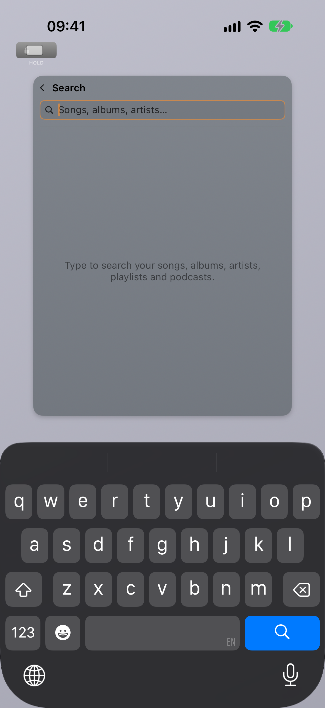
</p>

<p align="center">
  
</p>

### Spool

<p align="center">
  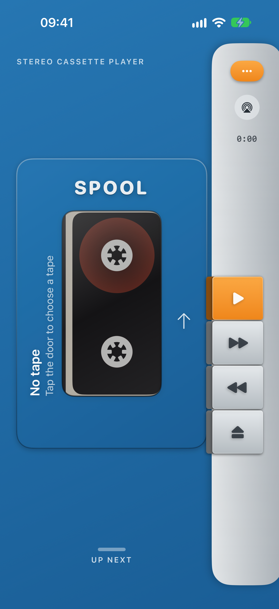
  &nbsp;
  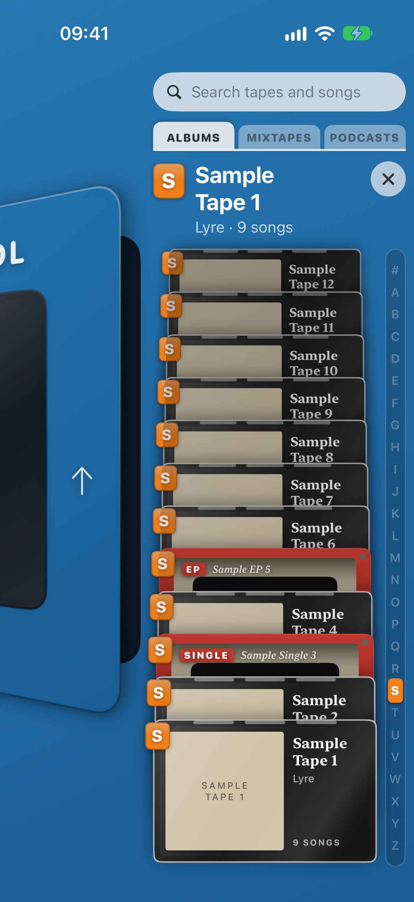
  &nbsp;
  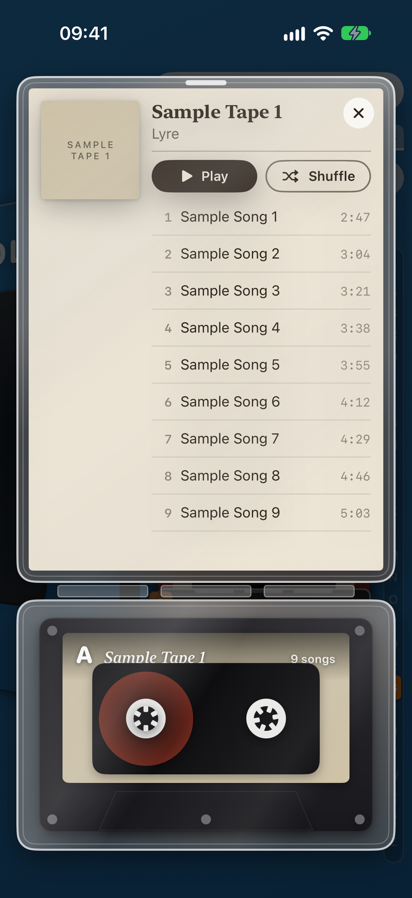
  &nbsp;
  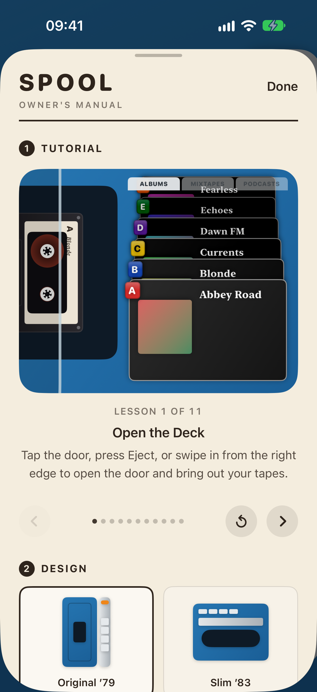
</p>

### Gramophone

<p align="center">
  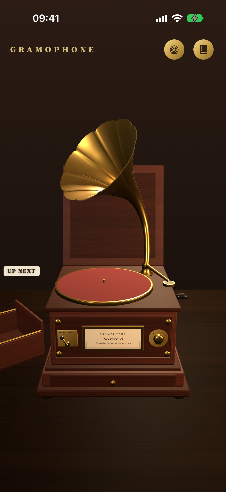
  &nbsp;
  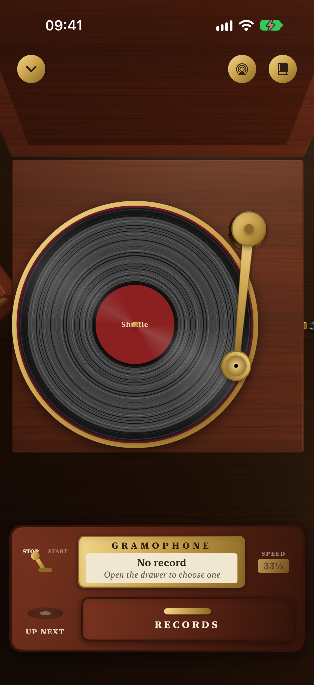
  &nbsp;
  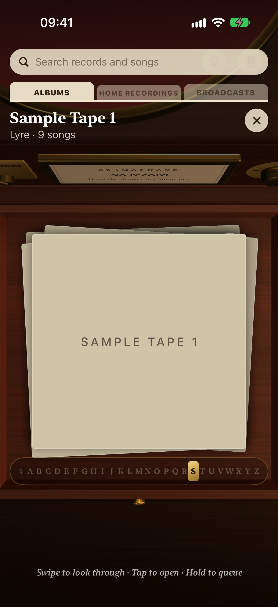
  &nbsp;
  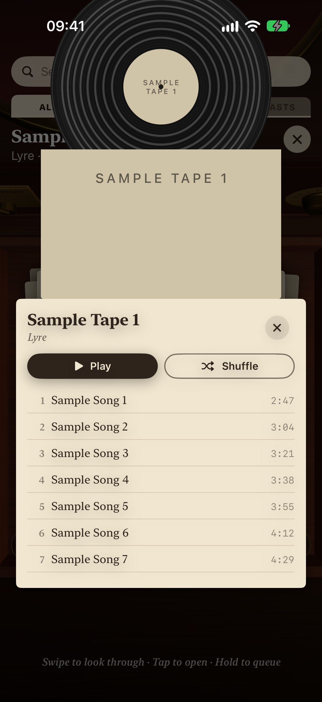
  &nbsp;
  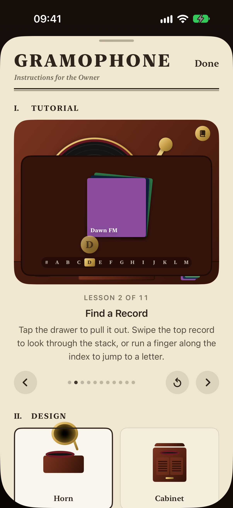
</p>

### iPhone Duo

<p align="center">
  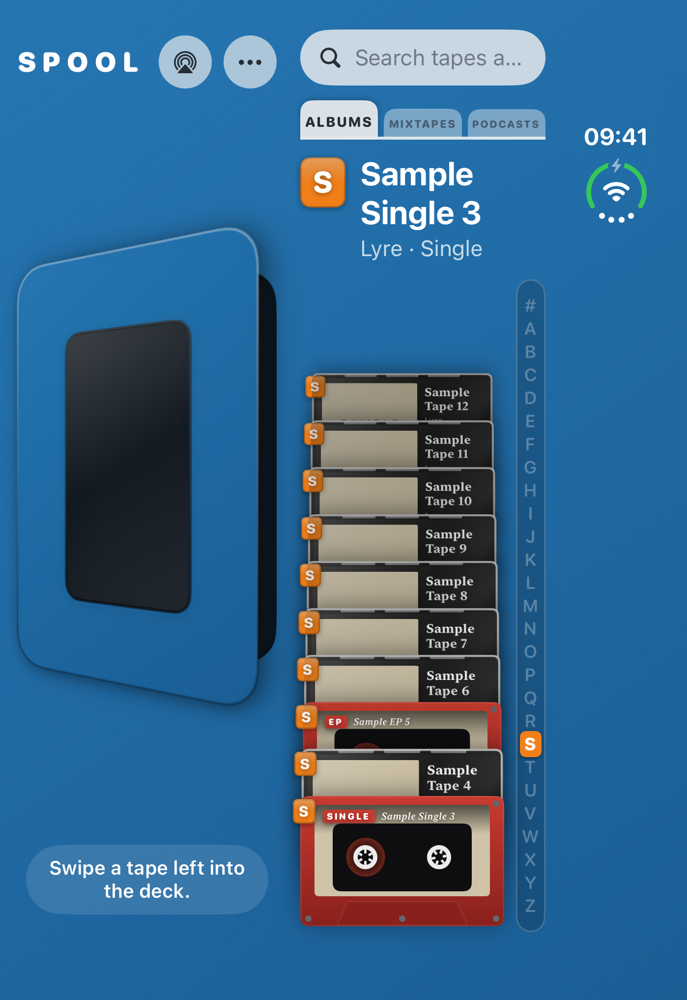
  &nbsp;
  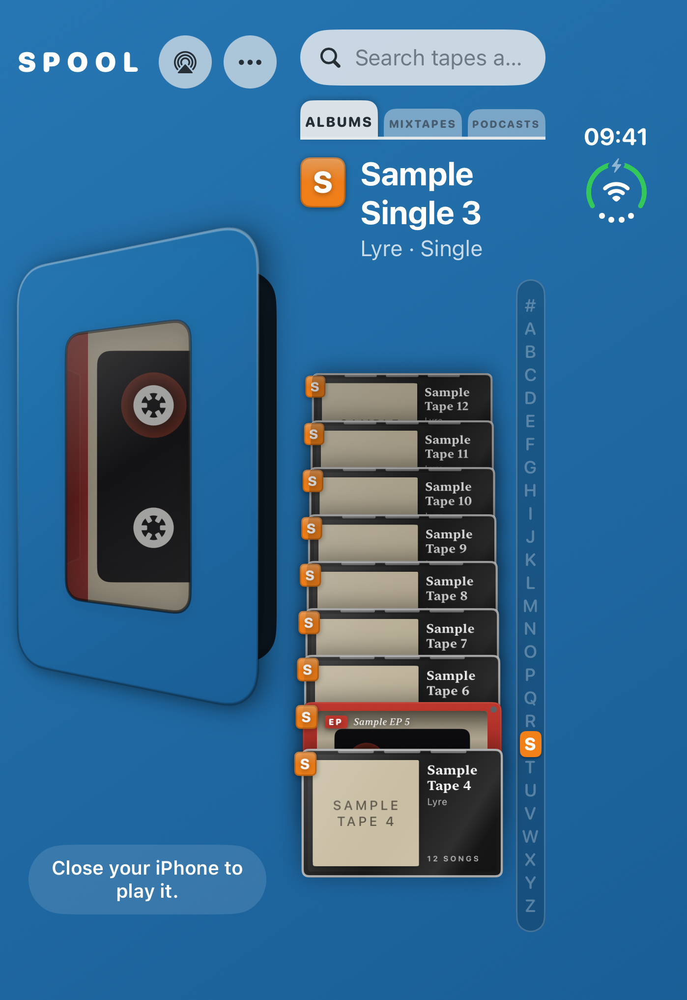
</p>

---

## Player Styles

Choose a player in **Settings → Player Style** (Classic), or from the Player section of the Spool's manual or the Gramophone's booklet. Switching keeps the music playing.

### Classic

The click-wheel player.

- **Touch Scroll Wheel** — Circular drag to scroll; tap zones for Menu, Play/Pause, Previous, Next, and center Select
- **Navigation Stack** — Menu acts as a true back button with full history
- **Selection Memory** — Every screen remembers your scroll position when you return
- **Hold Switch** — The switch at the top locks all input
- **Backlight Timer** — Auto-off: 5s / 10s / 30s / Always On; any touch wakes it
- **Search** — Type to search your library; the wheel lowers out of the way while the keyboard is up and comes back to scroll the results
- **Artwork Carousel** — Turn the phone sideways to browse Albums, Playlists or Podcasts by cover art, and open an album's gatefold sleeve
- **Shake to Shuffle** — Shake to shuffle every song
- **30 Finishes** — Signature, Pebble, Slim, Clip and Retro bodies, plus custom highlight colors and screen sizes

### Spool

A cassette deck, in two designs (Original ’79 and Slim ’83) and six finishes.

| Do this | And |
|---|---|
| Tap the door, press Eject, or swipe in from the right edge | The door opens on the tape rack |
| Drag the rack up or down | Flip through your tapes; a flick glides on and settles on a tape |
| Run a finger down the A–Z strip | Jump to a letter |
| Swipe the front tape left | It flies into the deck and plays |
| Tap an album's case | It opens on its J-card; tap a song to start the tape there |
| Hold a tape | Play Next, Add to Queue, or Show Songs |
| Swipe a tape right | Add it to the end of Up Next |
| Hold fast-forward or rewind | Wind through the song |
| Hold the door | Take out the playing album's case to pick another song |
| Hold Eject | Shuffle all your songs |
| Pull up the grip under the door | Up Next: tap to play, hold to move, swipe to remove |

Albums come in clear cases, singles and EPs as coloured cassingles, playlists as hand-labelled mixtapes, and podcasts as spoken-word tapes. The owner's manual opens with an animated tutorial.

### Gramophone

A 3D gramophone, in two designs (Horn and Cabinet) and four finishes (Mahogany, Golden Oak, Walnut, Black Lacquer).

| Do this | And |
|---|---|
| Flip the play switch | Start the record and look down at the turntable |
| Tap the drawer | Pull it out on the crate of records |
| Swipe the top record | Look through the stack |
| Run a finger along the A–Z strip | Jump to a letter |
| Tap a record | Open its sleeve; tap a song and the needle drops on it |
| Hold a record | Play Next or Add to Queue |
| Drag the tonearm | Lift it to pause; set it down on another band to play that song |
| Flip the brake | Stop and start without lifting the needle |
| Hold the record on the turntable | Open its sleeve and pick another song |
| Tap the bin of records | Go through Up Next: swipe down to flip, tap to play, hold to reorder, swipe left to remove |
| Wind the crank a full turn | Shuffle all your songs |

Playlists are home recordings and podcasts are broadcast transcriptions. The instruction booklet opens with an animated tutorial.

### The Same Controls Everywhere

| | Classic | Spool | Gramophone |
|---|---|---|---|
| Queue an album or a song | Hold, or swipe the center button (left Play Next, right Add to Queue) | Hold | Hold |
| Previous | Back to the song's start, then the song before | Same | (the tonearm) |
| Podcast skip | 15 s back, 30 s on | Same | (the tonearm) |
| Podcast speed | Now Playing → Speed | Speed knob | Speed knob |
| Shuffle and repeat | Now Playing | Manual → Playback | Booklet → Playback |
| Shuffle everything | Shake | Hold Eject | Wind the crank |
| Play from Up Next | Swipe left on the center button | Tap | Tap |
| Download an episode | Swipe right / hold | Hold | Hold |
| Search | Menu → Search | Search field over the rack | Search field over the crate |

---

## Search

Every player searches the library already on the phone, so results follow every keystroke. Every word must match somewhere, ignoring case and accents — "beyonce lemonade" finds *Lemonade* by Beyoncé.

- **Classic** lists matching artists, albums, songs, playlists and podcasts, for the wheel to scroll and play.
- **Spool and Gramophone** narrow the rack or crate to the tapes and records that match. A song brings up the album it's on, and each shelf divider counts its matches.

---

## iPhone Duo

On an unfolded iPhone Duo, the Spool lays out the deck on the left, with its door standing open, and the tape rack on the right.

1. Swipe a tape left out of the rack — it flies across into the open door with the sound of it going in. What was playing stops, as its tape has come out.
2. The tape waits in the deck, its place in the rack left empty, until…
3. …you close the phone. The door shuts with its sound, the motor runs up, and the tape plays.

The fold posture is read from the hinge (`onHingeChange`, iOS 27.1). Every other iPhone reports no hinge, so nothing changes there.

---

## Requirements

- iOS 26.5+
- Xcode 27.1+ (for the iPhone Duo SDK)
- Apple Developer account (MusicKit capability required)
- Physical iOS device (MusicKit needs a real device for full library access)
- Apple Music subscription or local library

---

## Setup

### 1. Add MusicKit Capability

1. Open `Lyre/Lyre.xcodeproj` in Xcode
2. Select the **Lyre** target
3. Go to **Signing & Capabilities**
4. Click **+ Capability** → add **MusicKit**
5. Set your Team under Signing

### 2. Verify Info.plist

`NSAppleMusicUsageDescription` is supplied via the `INFOPLIST_KEY_NSAppleMusicUsageDescription` build setting (must remain intact):

```xml
<key>NSAppleMusicUsageDescription</key>
<string>Lyre plays music from your Apple Music library to give you a classic scroll-wheel listening experience.</string>
```

### 3. Build and Run

1. Select a physical iOS device as the run destination
2. Build and run (`⌘R`)
3. Grant Apple Music permission when prompted on first launch
4. Pick a player during onboarding, or later in Settings

---

## Classic Navigation

### Scroll Wheel Controls

| Gesture / Button | Action |
|---|---|
| Circular drag clockwise | Scroll down |
| Circular drag counter-clockwise | Scroll up |
| Tap top zone (Menu) | Go back |
| Tap bottom zone (Play/Pause) | Toggle Play/Pause |
| Tap left zone (Prev) | Restart the song, or skip to the previous one; 15 s back on a podcast |
| Tap right zone (Next) | Skip to the next song; 30 s on on a podcast |
| Center circle (Select) | Select / confirm |
| Swipe across the center | Left: Play Next · Right: Add to Queue |

### Main Menu Structure

```
Menu
├── Now Playing
├── Queue
├── Songs
├── Recently Added
├── Recently Played
├── Albums
├── Artists
├── Playlists
├── Podcasts
├── Search
└── Settings
    ├── Theme
    ├── Screen Size
    ├── Highlight Color
    ├── Scroll Sensitivity
    ├── Click Sound
    ├── Backlight
    ├── Player Style
    └── About
```

---

## Configuration

Classic settings are under **Main Menu → Settings**:

| Setting | Options |
|---|---|
| Theme | 30 built-in finishes |
| Screen Size | Auto (match theme) + 6 manual presets (Tiny → Extra Large) |
| Highlight Color | Default or custom finish colors |
| Scroll Sensitivity | Low / Medium / High |
| Click Sound | On / Off |
| Backlight | 5 Seconds / 10 Seconds / 30 Seconds / Always On |
| Player Style | Classic / Spool / Gramophone |

The Spool's owner's manual and the Gramophone's instruction booklet hold their own settings: tutorial, design, finish, sound, playback (shuffle, repeat, podcast speed) and player.

---

## Troubleshooting

**"No songs in library"**
Grant Apple Music permission in Settings → Privacy → Media & Apple Music, and make sure your library has content.

**Scroll wheel not responding**
Swipe in a circular arc around the outer ring. If it feels sluggish, increase sensitivity in Settings → Scroll Sensitivity.

**Playback doesn't start**
MusicKit requires an active internet connection for streamed content. Verify you're signed in to Apple Music in iOS Settings.

**Hold switch appears stuck**
Tap the switch at the top of the device to unlock.

**Screen dims too quickly**
Go to Settings → Backlight and increase the duration or set Always On.

---

## Architecture

```
Lyre/Lyre/
├── Models/
│   ├── AppMusicModels.swift            # AppTrack, AppAlbum, AppArtist, AppPlaylist
│   ├── ModelsLyreScreen.swift          # LyreScreen enum (all Classic navigation states)
│   ├── PlayerStyle.swift               # Classic / Spool / Gramophone
│   ├── LibrarySearch.swift             # Search, shared by every player
│   ├── FoldPosture.swift               # iPhone Duo hinge → closed / open / tent
│   ├── TapeFormat.swift / TapeTransport.swift
│   └── …theme, colour and selection models
├── Services/
│   ├── MusicService.swift              # MusicKit + MediaPlayer integration
│   ├── PlayerActions.swift             # Previous, podcast skip and downloads, shared by every player
│   ├── PodcastStreamPlayer.swift / PodcastDownloads.swift / PodcastDirectory.swift
│   └── LibraryCache.swift / LibraryScanner.swift / AppMetrics.swift
└── ViewModels/
    ├── LyreView.swift                  # Root: picks the player, orientation, shake
    ├── ScrollWheelView.swift           # Classic wheel gestures + navigation
    ├── LyreScreenView.swift            # Classic screen router
    ├── SearchView.swift / NowPlayingView.swift / QueueView.swift / …
    ├── ArtworkCarouselView.swift / GatefoldView.swift
    ├── Players/                        # Shared by the Spool and the Gramophone
    │   ├── ShelfLibrary.swift          # Albums, mixtapes and podcasts as things on a shelf
    │   ├── ShelfSearchField.swift      # Search over the rack or the crate
    │   ├── ShelfIndexStrip.swift       # The A–Z index
    │   ├── TourPager.swift             # The tutorials
    │   └── KeyboardMonitor.swift
    ├── Spool/                          # The cassette deck
    │   ├── SpoolPlayerView.swift       # Deck, keys, tape changes, iPhone Duo layout
    │   ├── TapeCarousel.swift          # The rack
    │   ├── CassetteCaseView.swift / CassetteDoor.swift / CassetteView.swift
    │   └── SpoolQueueTray.swift / SpoolSettingsView.swift / SpoolTour.swift
    └── Gramophone/                     # The gramophone
        ├── GramophonePlayerView.swift  # Machine, camera, crate, Up Next bin
        ├── GramophoneStage.swift       # SceneKit 3D machine
        ├── RecordStackView.swift / RecordSleeveView.swift / RecordIndexStrip.swift
        └── GramophoneSettingsView.swift / GramophoneTour.swift
```

**Key design notes:**
- Every player drives the same `MusicService`, so switching players mid-song keeps playing, and the queue follows the same rules everywhere
- Classic navigation is a `[LyreScreen]` stack managed in `LyreView`, driven by `ScrollWheelView` via bindings, with a `[LyreScreen: SelectionState]` dictionary for O(1) scroll memory
- The Spool's rack and the Gramophone's crate share `ShelfLibrary`, search and the A–Z index, so a mixtape or a podcast behaves the same in both
- Layout follows the window's shape and, on iPhone Duo, the hinge's posture — never the device's model

---

## UI Tests and Screenshots

UI tests run on the simulator with sample tapes and records (`-SpoolSampleTapes YES`), since a simulator has no music library. The screenshots in this README come from `LyreUITests/ScreenshotTests.swift`, which only runs when asked:

```sh
TEST_RUNNER_LYRE_SCREENSHOTS=1 xcodebuild test -scheme Lyre \
  -destination 'platform=iOS Simulator,name=iPhone 18 Pro' \
  -only-testing:LyreUITests/ScreenshotTests
```

Run `testSpoolOnAnOpenDuo` on the iPhone Duo simulator for the Duo screenshots.

---

## Adding a New Theme

See [`Lyre/Lyre/Docs/ADD-NEW-THEME-GUIDE.md`](Lyre/Lyre/Docs/ADD-NEW-THEME-GUIDE.md). The short version:

1. Add a case to `LyreThemeStyle` in `Models/ThemeLyreThemeStyle.swift`
2. Add a `case` block in `LyreTheme.theme(for:)` in `Models/LyreTheme.swift`
3. Build — the theme appears in Settings → Theme automatically

---

## License

For educational and personal use. Design inspired by classic scroll-wheel music players, cassette decks and gramophones. Apple Music and MusicKit are trademarks of Apple Inc. This project is not affiliated with or endorsed by Apple.

## Credits

Built with SwiftUI, SceneKit, MusicKit, MediaPlayer, CoreMotion, and MetricKit.
