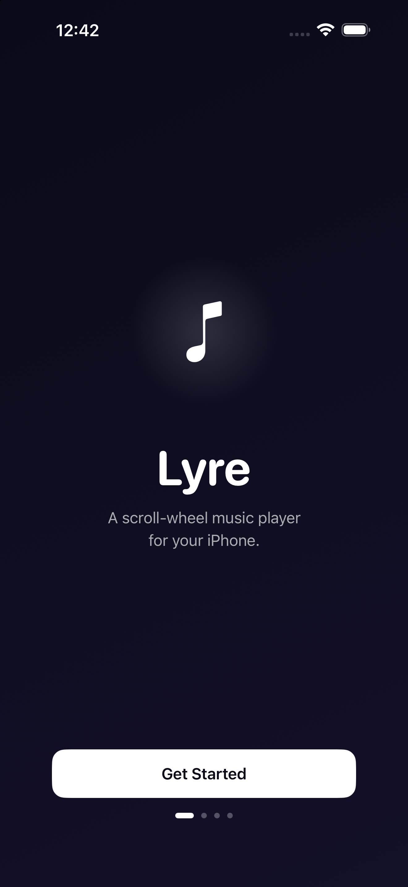
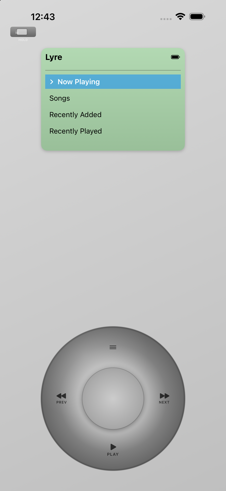
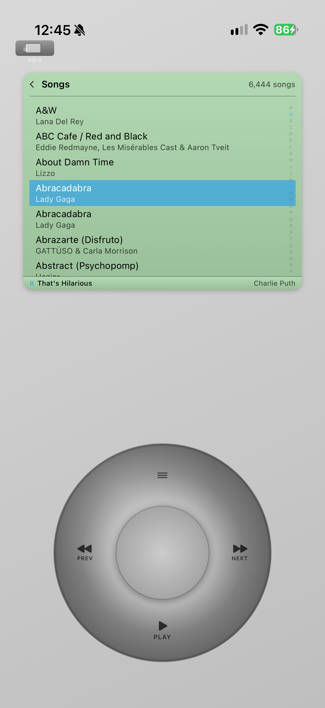
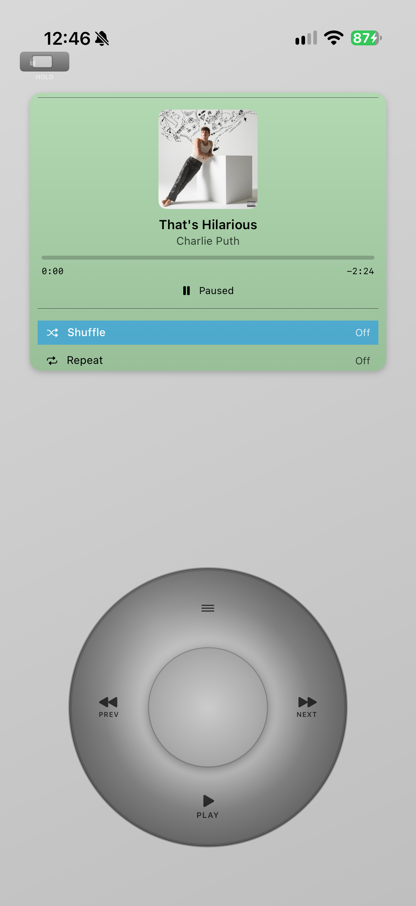
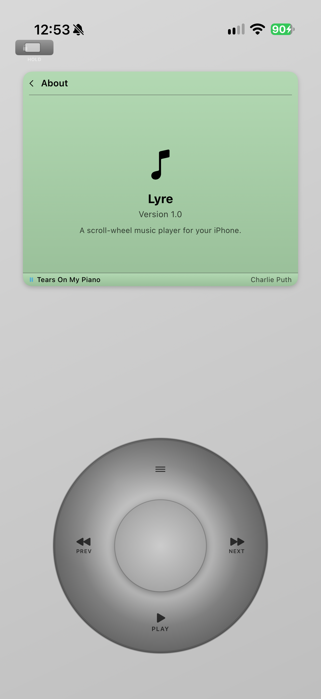
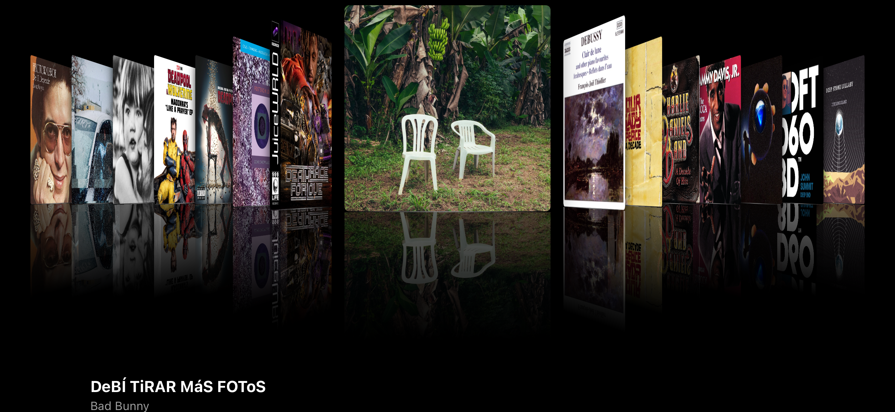

# Lyre

A nostalgic, scroll-wheel-driven music player for iPhone.

Lyre is a SwiftUI iOS app with a circular scroll-wheel interface and full Apple Music library integration — browse your songs, albums, artists, playlists, and podcasts by spinning and tapping instead of scrolling flat lists.

---

## Screenshots

<p align="center">
  
  &nbsp;&nbsp;
  
  &nbsp;&nbsp;
  
  &nbsp;&nbsp;
  
  &nbsp;&nbsp;
  
</p>

<p align="center">
  
</p>

---

## Features

### Core Experience
- **Touch Scroll Wheel** — Circular drag to scroll; tap zones for Menu, Play/Pause, Previous, Next, and center Select
- **Navigation Stack** — Menu button acts as a true back button with full history
- **Selection Memory** — Every screen remembers your scroll position when you return
- **Hold Switch** — Orange indicator at the top locks all input
- **Backlight Timer** — Auto-off: 5s / 10s / 30s / Always On; any touch wakes it
- **Haptic Feedback** — Ticks on scroll, medium on selection, heavy on center press, rigid on edge
- **Shake to Shuffle** — Shake the device to instantly shuffle all songs and jump to Now Playing

### Playback
- **Apple Music Library** — Browse and play Songs, Albums, Artists, Playlists, and Podcasts via MusicKit
- **Track Scrubbing** — Rotate the wheel on Now Playing to seek ±5 seconds per step
- **Repeat & Shuffle** — Toggle from the Now Playing screen using the center button
- **Background Audio** — Playback runs through the system music player, so it continues when the app is backgrounded or the screen is off
- **Artwork Carousel** — Rotate to landscape to browse Albums, Playlists, or Podcasts with 3D cover art

### Themes

30 built-in finishes across five body styles — Signature, Special screens, Pebble (compact body), Slim (tall screen), and Clip (small square screen) — each styling the body gradient, screen colors, highlight color, and scroll wheel.

---

## Requirements

- iOS 17.0+
- Xcode 16.0+
- Apple Developer account (MusicKit capability required)
- Physical iOS device (MusicKit needs a real device for full library access)
- Apple Music subscription or local library

---

## Setup

### 1. Add MusicKit Capability

1. Open `Lyre/Lyre.xcodeproj` in Xcode
2. Select the **Lyre** target
3. Go to **Signing & Capabilities**
4. Click **+ Capability** → add **MusicKit**
5. Set your Team under Signing

### 2. Verify Info.plist

`NSAppleMusicUsageDescription` is supplied via the `INFOPLIST_KEY_NSAppleMusicUsageDescription` build setting (must remain intact):

```xml
<key>NSAppleMusicUsageDescription</key>
<string>Lyre plays music from your Apple Music library to give you a classic scroll-wheel listening experience.</string>
```

Playback runs through the system music player (`MPMusicPlayerController.systemMusicPlayer`), so no `UIBackgroundModes` entry is needed for audio to continue in the background.

### 3. Build and Run

1. Select a physical iOS device as the run destination
2. Build and run (`⌘R`)
3. Grant Apple Music permission when prompted on first launch
4. Navigate with the scroll wheel

---

## Navigation

### Scroll Wheel Controls

| Gesture / Button | Action |
|---|---|
| Circular drag clockwise | Scroll down |
| Circular drag counter-clockwise | Scroll up |
| Tap top zone (Menu) | Go back |
| Tap bottom zone (Play/Pause) | Toggle Play/Pause |
| Tap left zone (Prev) | Restart track or skip to previous |
| Tap right zone (Next) | Skip to next track |
| Center circle (Select) | Select / confirm |

### Main Menu Structure

```
Menu
├── Now Playing
├── Songs
├── Recently Added
├── Recently Played
├── Albums
├── Artists
├── Playlists
├── Podcasts
└── Settings
    ├── Theme
    ├── Screen Size
    ├── Highlight Color
    ├── Scroll Sensitivity
    ├── Click Sound
    ├── Backlight
    └── About
```

### Artwork Carousel

Rotate to landscape while browsing Albums, Playlists, or Podcasts to enter the artwork carousel. Swipe left/right to browse, tap to select.

### Shake to Shuffle

Shake the device from any screen (Hold disabled) to immediately shuffle all songs and navigate to Now Playing.

---

## Configuration

All settings are accessible from **Main Menu → Settings**:

| Setting | Options |
|---|---|
| Theme | 29 built-in themes |
| Screen Size | Auto (match theme) + 6 manual presets (Tiny → Extra Large) |
| Highlight Color | Default or 16 custom finish colors |
| Scroll Sensitivity | Low / Medium / High |
| Click Sound | On / Off |
| Backlight | 5 Seconds / 10 Seconds / 30 Seconds / Always On |

---

## Troubleshooting

**"No songs in library"**
Grant Apple Music permission in Settings → Privacy → Media & Apple Music, and make sure your library has content.

**Scroll wheel not responding**
Swipe in a circular arc around the outer ring. If it feels sluggish, increase sensitivity in Settings → Scroll Sensitivity.

**Playback doesn't start**
MusicKit requires an active internet connection for streamed content. Verify you're signed in to Apple Music in iOS Settings.

**Hold switch appears stuck**
Tap the orange toggle at the top of the device to unlock.

**Screen dims too quickly**
Go to Settings → Backlight and increase the duration or set Always On.

---

## Architecture

```
Lyre/Lyre/
├── Models/
│   ├── AppMusicModels.swift            # AppTrack, AppAlbum, AppArtist wrappers
│   ├── ModelsLyreScreen.swift          # LyreScreen enum (all navigation states)
│   ├── ModelsSelectionState.swift      # SelectionState for scroll memory
│   ├── ModelsRepeatMode.swift
│   ├── ModelsShuffleMode.swift
│   ├── LyreTheme.swift                 # Theme colors + factory
│   ├── ThemeLyreThemeStyle.swift       # 29 theme cases + defaultScreenSize
│   ├── ThemeScreenSize.swift           # 6 screen size presets
│   └── LyreColors.swift                # Finish color palette
├── Services/
│   ├── MusicService.swift              # MusicKit + MPMediaPlayer integration
│   ├── AppHelpers.swift                # Shared utilities
│   └── AppMetrics.swift                # MetricKit crash/hang monitoring
└── ViewModels/
    ├── LyreView.swift                  # Root view — layout, orientation, shake
    ├── ScrollWheelView.swift           # Wheel gestures + navigation logic
    ├── LyreScreenView.swift            # Screen content router
    ├── ModelsThemeSettings.swift       # ThemeSettings observable
    ├── NowPlayingView.swift
    ├── MainMenuView.swift
    ├── SongListView.swift
    ├── AlbumListView.swift / AlbumDetailView.swift
    ├── ArtistListView.swift / ArtistDetailView.swift
    ├── PlaylistListView.swift / PlaylistDetailView.swift
    ├── PodcastListView.swift / PodcastDetailView.swift
    ├── SettingsView.swift
    ├── ArtworkCarouselView.swift
    ├── AlphabetScrubberView.swift
    └── HoldSwitchView.swift
```

**Key design notes:**
- Navigation is a `[LyreScreen]` stack managed in `LyreView`, driven by `ScrollWheelView` via bindings
- Selection memory is a `[LyreScreen: SelectionState]` dictionary — O(1) save/restore on every transition
- `ThemeSettings` is a reference type in `@State`, passed down so changes propagate immediately without re-rendering the full tree
- All async work uses Swift async/await — no Combine

---

## Adding a New Theme

See [`Lyre/Lyre/Docs/ADD-NEW-THEME-GUIDE.md`](Lyre/Lyre/Docs/ADD-NEW-THEME-GUIDE.md). The short version:

1. Add a case to `LyreThemeStyle` in `Models/ThemeLyreThemeStyle.swift`
2. Add a `case` block in `LyreTheme.theme(for:)` in `Models/LyreTheme.swift`
3. Build — the theme appears in Settings → Theme automatically

---

## License

For educational and personal use. Design inspired by classic scroll-wheel music players. Apple Music and MusicKit are trademarks of Apple Inc. This project is not affiliated with or endorsed by Apple.

## Credits

Built with SwiftUI, MusicKit, MediaPlayer, CoreMotion, and MetricKit.
